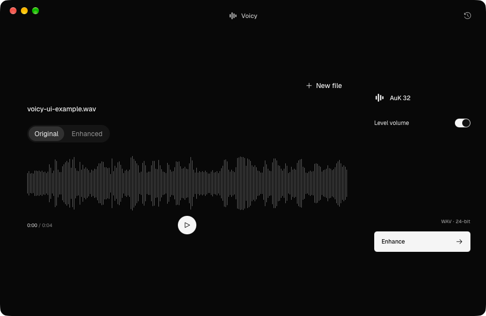
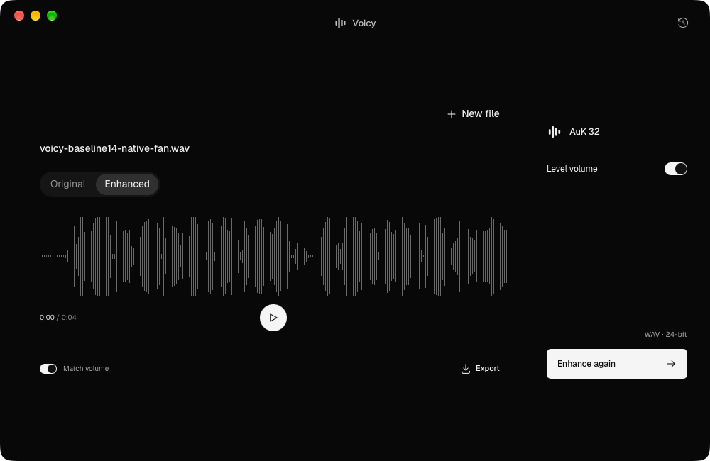

# Voicy 0.3.3 app gallery

Captured 20 October 2026 from the actual signed and notarized [public release](https://github.com/jindratilk/voicy/releases/tag/v0.3.3), opened normally from its read-only disk image on the developer Mac. These are unedited native-window captures, 1000 × 650 pixels each. The native About dialog confirmed `0.3.3 (0.3.3)`; source and capture evidence is retained privately.

## Load an original recording

A local 4.905-second example is loaded. Original is selected, Enhanced is disabled, and Enhance is available. This view has no processed result; enhancement was not started for this import.

## Return to an existing result

The recording-history control reopened the actual result from the **18 October public 0.3.3 qualification**. Enhanced, Match volume and Export are visible. The complete current job record equals its saved qualification record. This is an existing result restored on 20 October, not a fresh inference run or listening assessment.

## Silent controls walkthrough

[Watch the 30-second MP4](https://usevoicy.app/videos/voicy-0.3.3-controls.mp4) · 1000 × 650 · 69,030 bytes · no audio track.

### Equivalent text

The actual 0.3.3 window contains the previously enhanced `voicy-baseline14-native-fan.wav` example. Original is initially selected and playback is paused partway through the short recording. Play starts the moving playback position. Selecting Enhanced changes the displayed waveform to the saved result. Match volume is turned off and back on. Play starts the saved result again, and Pause stops it. The tabs are switched once more while paused; the clip ends on Enhanced. Export and “WAV · 24-bit” remain visible throughout. The video does not open a save dialog or perform a new export.

This demonstrates controls on the **same 18 October qualified result** shown above. It does not show a new import or enhancement, processing time, an audible comparison or better sound than Adobe. No new model run or human listening assessment was performed.

### Recording method

Captured 20 October from the actual public signed/notarized 0.3.3 app, opened normally from its read-only disk image on the developer Mac. The complete job record matched the earlier qualification before and after capture. Only the app window was recorded; all 175 retained frames were reviewed for private paths, accounts and unrelated windows.

The silent recording samples the real window at approximately 5.8 frames per second. H.264 encoding preserves every recorded presentation timestamp; no interpolated frames, reconstructed UI, speedup or added audio. Duration is 30.246 seconds. Playback timing in this interface demonstration is not a processing benchmark. The first capture had an unusable timing conversion and was rejected; both attempts and their original evidence remain private. The app was quit normally, original preference bytes restored and the image ejected afterward.

MP4 SHA256: `cf73eda373cd69bbf1227bbcb56c194dd7e20b38c6f3f24b6aaf2d803520ea51`. The waveform uses the same licensed case and attribution below. The text equivalent follows [W3C's prerecorded video-only guidance](https://www.w3.org/WAI/WCAG22/Understanding/audio-only-and-video-only-prerecorded.html). This supplemental asset is not a dedicated Google video watch page or a claim of video indexing.

## Source and limits

The complete source image is 6,510,981,427 bytes, SHA256 `459f8699304ec2efa923001b0691a9fd3231067716a66b18f676f88f4c4f6e7b`. Its whole-image hash, app signature and Gatekeeper assessment passed again before capture. The launched translocated executable and version plist match the mounted image. See [qualification and its scope](https://github.com/jindratilk/voicy/releases/download/v0.3.3/QUALIFICATION.json). The app was run from the disk image, not an Applications copy.

The visible waveform comes from [E03 case 1](../growth/E03-MANIFEST.json): LibriSpeech utterance `61-70968-0000`, resampled, normalized and mixed with simulated fan noise under the fixed [recipe](../growth/E03-PROTOCOL.md). Attribution: LibriSpeech (c) 2014 Vassil Panayotov, prepared with assistance from Daniel Povey; Panayotov, Chen, Povey and Khudanpur, ICASSP 2015. Source: [OpenSLR 12](https://www.openslr.org/12), [CC BY 4.0](https://creativecommons.org/licenses/by/4.0/). The gallery shows interface waveforms only; it publishes no new audio.

Screenshots cannot establish sound quality, intelligibility, processing speed or broad reliability. The [failed current five-case run](../growth/E03-033-CURRENT-RESULTS.md), below-recommendation hosted hardware and absence of independent listening remain relevant. These images do not replace those limits or establish better results than Adobe.

| Unchanged PNG | SHA256 |
| --- | --- |
| Original loaded | `ab6182c0a81826bd2388e59a0a1ae421fd017f16a418d12ebc6c922e0ed9937e` |
| Restored result | `7c3015d56a0a96f00eacc37d5b61f03b9d338f92123a4481d8598e63526ee689` |

Both PNG captures were inspected for private paths, account information and unrelated windows before publication. They contain only the product and task-owned fixture names. No mock UI, compositing or resampling was used. A destination's actual gallery/video dimensions and format, maker identity and submission rules still need checking before an explicitly authorized submission. The silent controls walkthrough is not a complete launch package; no third-party listing is created here.
